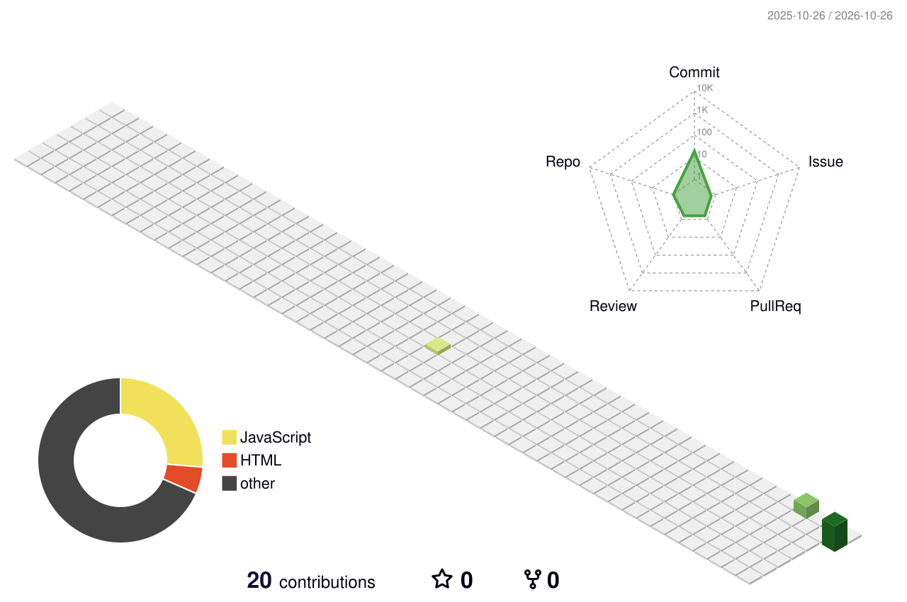

<!-- ===================== HEADER ===================== -->

  

  

<!-- Deretan ikon 3D (Microsoft Fluent Emoji, lisensi MIT) -->

  
  &nbsp;
  
  &nbsp;
  
  &nbsp;
  
  &nbsp;
  

  
  

##  Tentang Saya

<table align="center">
  <tr>
    <td width="62%" valign="top">

- 🔭 Fokus mengembangkan aplikasi **Decision Support System (SPK)** dan antarmuka web yang interaktif.
- ⚡ Menggemari eksplorasi **desain UI/UX**, **arsitektur database**, dan **optimalisasi sistem**.
- 🎓 Mahasiswa Sistem Informasi yang suka mengubah data menjadi keputusan yang berguna.

    </td>
    <td width="38%" align="center">
      
    </td>
  </tr>
</table>

##  Bahasa & Alat Pemrograman

  
  
  
  
  
  

##  Statistik GitHub

<!-- Kalender kontribusi 3D beranimasi.
     File SVG ini dibuat oleh workflow .github/workflows/profile-3d.yml,
     jadi gambar baru muncul setelah workflow dijalankan satu kali. -->

  

  
  

  

  

  

<!--
## 🚀 Proyek Unggulan
Hapus tanda komentar ini, lalu ganti NAMA-REPO dengan nama repositori kamu.

  
  

-->

##  Terhubung dengan Saya

  
  <!-- Tambahkan LinkedIn / Instagram / Email kamu di sini, contoh:
  
  -->

  

  

