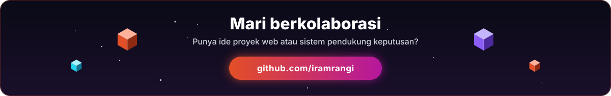

<!-- ===================== HEADER ===================== -->

  

  

  
  

## Tentang Saya

  

## Statistik GitHub

<!-- Kalender kontribusi 3D beranimasi.
     File SVG ini dibuat oleh workflow .github/workflows/profile-3d.yml,
     jadi gambar baru muncul setelah workflow dijalankan satu kali. -->

  

  
  

  

## Proyek Unggulan

  

<!-- Untuk menambah proyek lain, salin blok <a>...</a> di atas lalu ganti BorneoWebmu dengan nama repositori. -->

## Terhubung dengan Saya

  

<!-- Tambahkan LinkedIn / Instagram / Email kamu di sini, contoh:

  

-->

  

